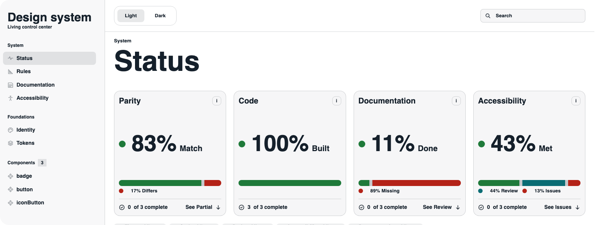
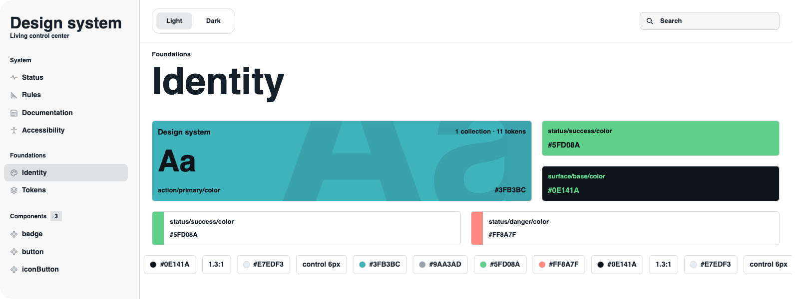

# **Design systems beyond the Figma file**

I’m a freelance Design Systems Architect and Brand Identity Lead based in Lisbon.
I build open-source tools for understanding, maintaining and evolving design systems across Figma, code and AI.

---

### **RMS Design System Engine**

 

**From fragmented tools to shared design system intelligence.** One engine connects Figma, code, documentation and decisions, so designers, developers and AI agents work from the same source.

- **Audit.** Your Figma library's rules, Figma-code parity as a real browser draws it (Chrome, Firefox and Safari), and accessibility to WCAG 2.2 AA.
- **Document.** A contract per component and its usage guidelines, written from Figma and the code, in W3C DTCG and DSDS.
- **Collaborate.** A living style guide, rebuilt on every push, that says who needs to do what next.
- **Keep AI on the system.** Agents read the same contracts, and the checks catch what they invent.

[See the live style guide](https://rafaelmatosdasilva.github.io/rms-ds-figma-plugins/) · [Features](https://github.com/rafaelmatosdasilva/rms-design-system-engine/blob/main/docs/features.md) · [Get started](https://github.com/rafaelmatosdasilva/rms-design-system-engine#get-started)

---

[Personal Website](https://www.rafaelmatosdasilva.com) · [LinkedIn](https://www.linkedin.com/in/rafaelmatosdasilva)
