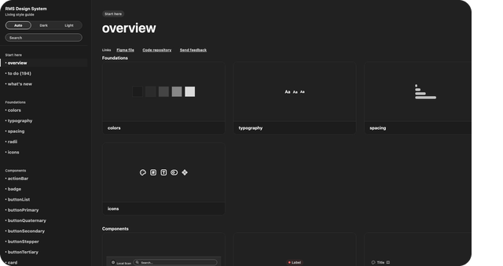
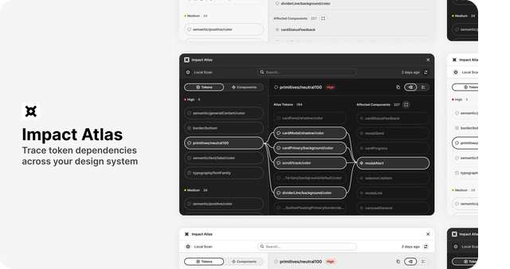
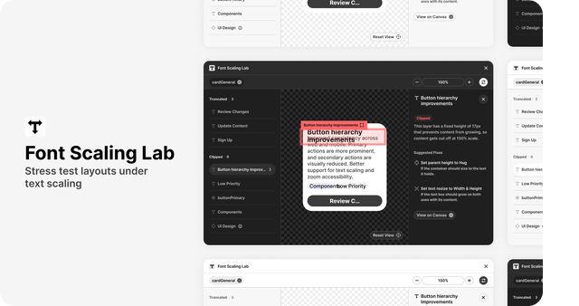
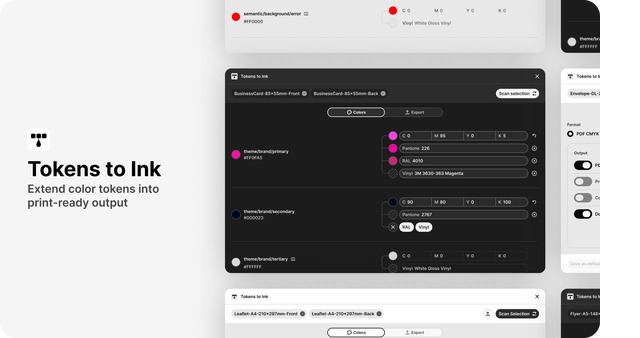

# **Design systems beyond the Figma file**

I’m a freelance Design Systems Architect and Brand Identity Lead based in Lisbon.
I build open-source tools for understanding, maintaining and evolving design systems across Figma, code and AI.

---

### **Open Source tools for design systems**

<a href="https://github.com/rafaelmatosdasilva/rms-design-system-engine"><b>rms-design-system-engine</b></a> The core of your design system. Keep designers, developers and AI agents aligned, generate documentation and contracts, and maintain parity between Figma and code. 

<a href="https://github.com/rafaelmatosdasilva/rms-figma-impact-atlas"><b>rms-figma-impact-atlas</b></a> Understand how changes move through your design system. Trace token dependencies, see what’s affected, and understand how changes propagate across tokens and components. 

<a href="https://github.com/rafaelmatosdasilva/rms-figma-font-scaling-lab"><b>rms-figma-font-scaling-lab</b></a> Test how your typography behaves beyond ideal layouts. Simulate text scaling and changing content to uncover overflow, broken layouts, and accessibility issues. 

<a href="https://github.com/rafaelmatosdasilva/rms-figma-tokens-to-ink"><b>rms-figma-tokens-to-ink</b></a> Take your design system beyond the screen. Extend Figma color variables into print-ready values and keep colors consistent across digital and physical output. 

---

[Personal Website](https://www.rafaelmatosdasilva.com) · [LinkedIn](https://www.linkedin.com/in/rafaelmatosdasilva)
